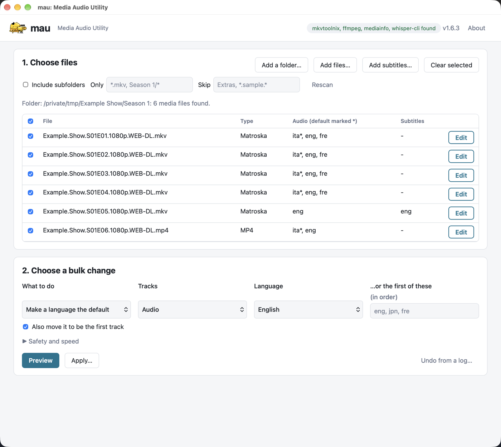
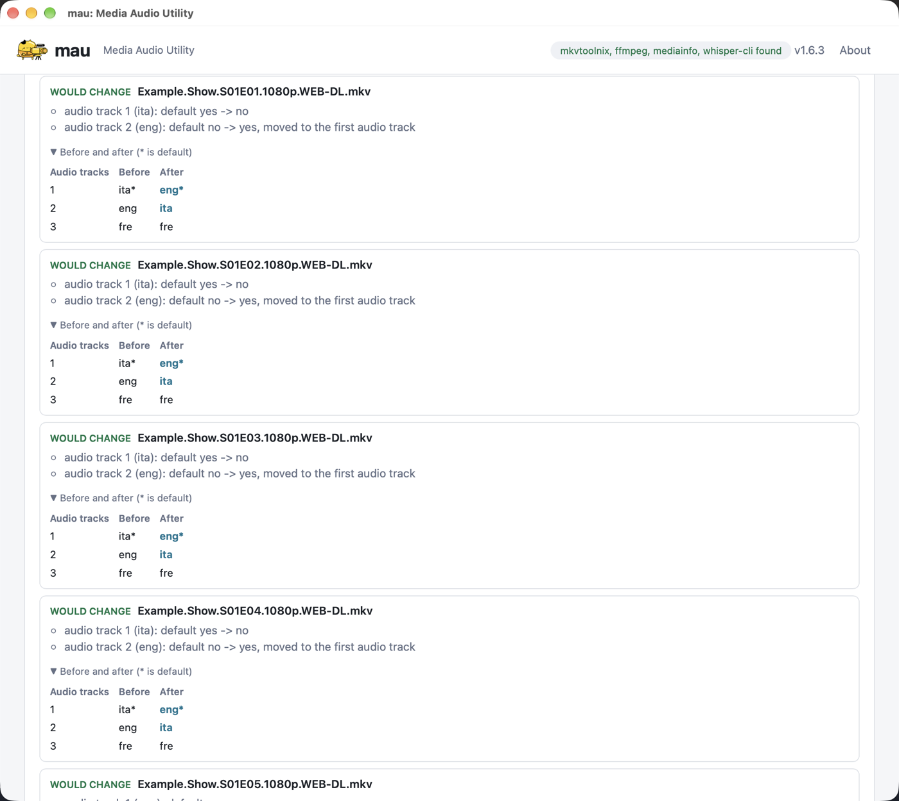
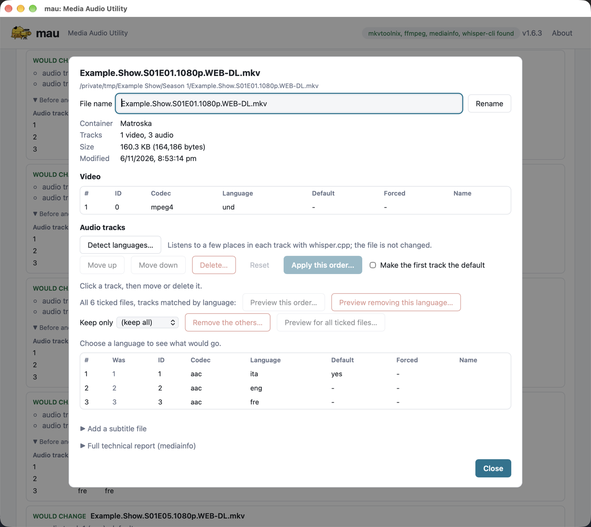
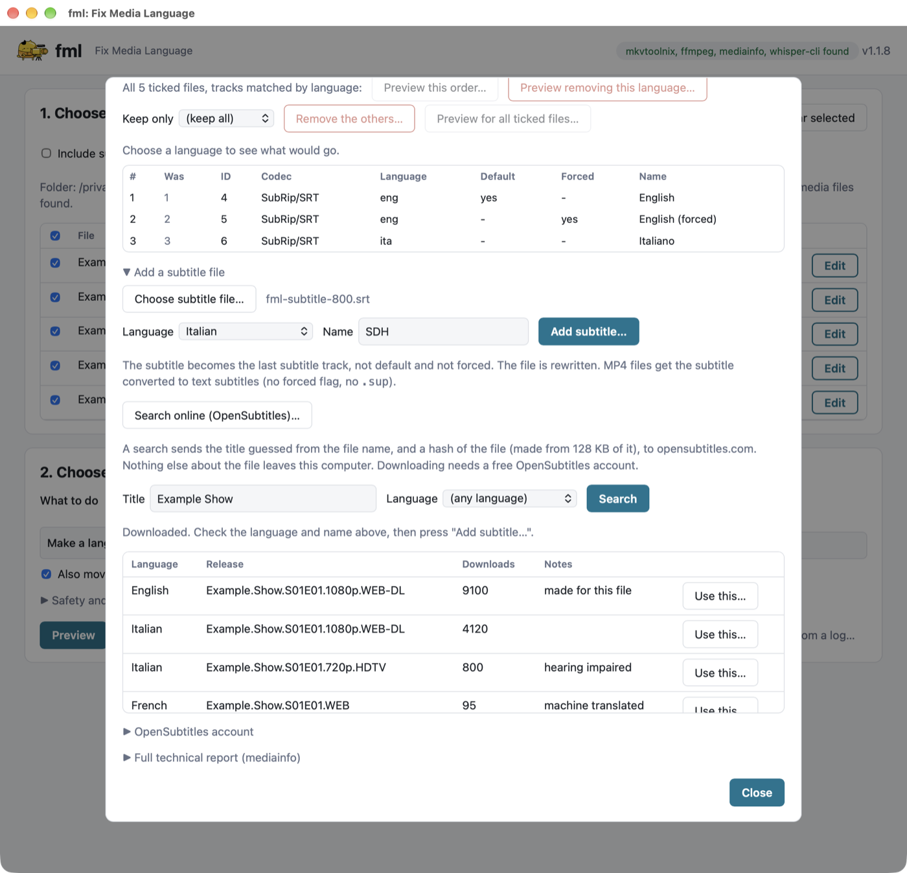
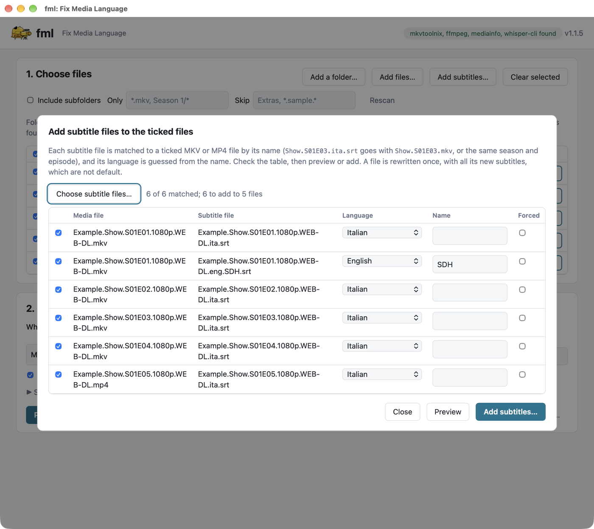
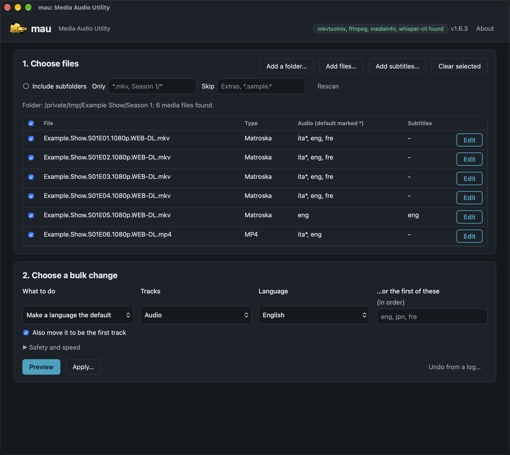

# mau

**Media Audio Utility**: change the default audio and subtitle tracks of your media files, and tidy their tracks, from the command line or a desktop app.

Version 1.6.3



## Contents

- [What it does](#what-it-does)
- [Quick start](#quick-start)
- [Requirements](#requirements)
- [Installing](#installing)
- [The desktop app](#the-desktop-app)
- [Using the command line](#using-the-command-line)
  - [Basics](#basics)
  - [Choosing a track](#choosing-a-track)
  - [Removing tracks](#removing-tracks)
  - [Subtitles](#subtitles)
  - [Languages](#languages)
  - [Moving and ordering tracks](#moving-and-ordering-tracks)
  - [Names, forced flags and other track settings](#names-forced-flags-and-other-track-settings)
  - [Adding subtitle files](#adding-subtitle-files)
  - [Finding subtitles online](#finding-subtitles-online)
  - [Taking a subtitle track out to a file](#taking-a-subtitle-track-out-to-a-file)
  - [MP4 and AVI](#mp4-and-avi)
  - [Many files at once](#many-files-at-once)
  - [Several actions in one command](#several-actions-in-one-command)
  - [A whole season](#a-whole-season)
- [Safety](#safety)
  - [Dry runs](#dry-runs)
  - [Safe changes](#safe-changes)
  - [Keeping the original](#keeping-the-original)
  - [Undoing changes](#undoing-changes)
- [Reference](#reference)
  - [Output formats](#output-formats)
  - [Exit status](#exit-status)
  - [Help](#help)
- [Development](#development)
- [License and support](#license-and-support)
- [Attributions](#attributions)

## What it does

`mau` makes the audio and subtitle tracks of your media files what you want them to be, from the command line or a
desktop app. It was designed for one job, and has grown from there:

- **Make the right track the default**, and the first, for players that ignore the default flag. If a file has
  Italian audio first and English second and you want English, one command (or one click) fixes a whole season.
- **Tidy the tracks**: reorder, rename, retag the language, set the forced flag, remove tracks you don't want, keep
  only the languages you do.
- **Add and take out subtitles**: add `.srt`, `.ass`, `.vtt` or `.sup` files to a video (matched to a whole season
  by name, with the language guessed), or write a subtitle track out to a file.
- **Work on MKV, MP4 (M4V, MOV) and AVI files**, one file or a whole library at once.
- **Be careful with your files**: every change is made on a copy that is read back and checked before it replaces
  the original, there is a dry run for everything, backups are one switch, and a log lets you undo.

Changes are made on a copy that is checked and then swapped in (see [Safe changes](#safe-changes)). MKV
metadata edits only touch the metadata, so the audio and video are untouched. MP4 files, and tracks that
have to be removed, are rewritten without re-encoding anything.

## Quick start

```sh
./mau --check                                             # are the tools it needs installed?
./mau --info --file video.mkv                             # show the tracks of a file
./mau --set lang --default English --file video.mkv --dryrun    # show what would change
./mau --set lang --default English --move --dir /media/Show.S01 # make English the default and first, for a season
./mau --gui                                               # or do it in the desktop app
```

`./mau` runs the build in this directory; with `mau-cli` on your `PATH` use that name.
Before it runs, `./mau` brings that build up to date with `cargo` (a quick check that does nothing when the sources have not
changed), and `./mau --gui` does the same for the app. Set `MAU_NO_BUILD=1` to skip the check and run what is built.

## Requirements

`mau` is built with Rust (`cargo` 1.85 or newer, 1.90 for the desktop app) and has no other
dependencies of its own. It needs these commands:

| Command                   | Package    | Used for                      |
|---------------------------|------------|-------------------------------|
| `mkvmerge`, `mkvpropedit` | mkvtoolnix | editing MKV files             |
| `ffprobe` (with `ffmpeg`) | ffmpeg     | reading MKV files             |
| `mediainfo`               | mediainfo  | reading MP4 and AVI files     |
| `ffmpeg`                  | ffmpeg     | rewriting MP4 and AVI files   |

An MKV is read with `ffprobe`, so its track names (codecs such as `subrip`, `aac` and `ac3`, as `--info` shows them)
are the same in every build. The build made without mkvtoolnix (`./build.sh --target <t> --no-mkvtoolnix`, which compiles
the `no-mkvtoolnix` Cargo feature, and is the one for the App Store) does every MKV change with `ffmpeg` instead: flags, languages, names, reordering, removing and adding
tracks, and extracting subtitles. It never runs the mkvtoolnix commands, even when they are installed, and `--check`
does not ask for them.
Its installers and archive are named with `-no-mkvtoolnix`, and it is built in `rust/target-nomkv`, so the normal build's
files are not replaced. The test suite runs it with `MAU_BIN` set to that binary; it recognises the build from `--check`, which does not list
`mkvmerge` in that build (`MAU_SPIKE_NO_MKVTOOLNIX=1` also works, for a binary that hides the tools at run time).

Optional, for `--detect` (see [Guessing the language of a track](#guessing-the-language-of-a-track)):

| Command                   | Package     | Used for                      |
|---------------------------|-------------|-------------------------------|
| `whisper-cli`             | whisper.cpp | guessing a track's language   |

`--check` lists it and says it is optional, and `MAU_WHISPER_MODEL` (the model file). `--check --install` installs
`whisper.cpp` with apt (`whisper.cpp`) or Homebrew (`whisper-cpp`); on other systems it says to install it by hand.
It also downloads the model, if there is none: see [Guessing the language of a track](#guessing-the-language-of-a-track).

Check they are installed with `./mau --check`, and install any that are missing
with `./mau --check --install`, which uses the package manager of the system:

| System                                      | Command                                        |
|---------------------------------------------|------------------------------------------------|
| Debian, Ubuntu and what is built on them    | `sudo apt install -y`                          |
| Fedora, RHEL and what is built on them      | `sudo dnf install -y` (`ffmpeg-free`)          |
| Arch Linux and what is built on it          | `sudo pacman -S --noconfirm --needed` (`mkvtoolnix-cli`) |
| macOS                                       | `brew install`                                 |
| Windows                                     | `winget install --id ... --exact` (`MoritzBunkus.MKVToolNix`, `MediaArea.MediaInfo`, `Gyan.FFmpeg`), else `choco install -y` (`mediainfo-cli`) |

A Linux distribution is recognised by the `ID` and `ID_LIKE` in `/etc/os-release`, so a distribution built on one of
these is covered too. Any other system is told it is not known. The package names were checked against the
package repositories, but the installs on Fedora, Arch and Windows have not been run on those systems (only
the commands that would be run are tested; `--dryrun --verbose` shows them). Fedora's `ffmpeg-free` is enough for
mau, which copies streams; the full `ffmpeg` needs RPM Fusion.
Each action only needs the commands it uses, so an MKV-only setup works without `ffmpeg`.

The desktop app (`./mau --gui`) is optional and also needs the system webview (on Ubuntu `libwebkit2gtk-4.1-dev` and `libgtk-3-dev`).

## Installing

Build the command line tool, and the desktop app if you want it, from the `rust` folder:

```sh
cd rust
cargo build --release                # the command line tool: rust/target/release/mau-cli
cargo build -p mau-gui --release     # the desktop app: rust/target/release/mau
```

To put `mau-cli` on your `PATH`, copy the built files into a directory on it (the app beside the command):

```sh
install -m 755 rust/target/release/mau-cli rust/target/release/mau ~/.local/bin/
mau-cli --version
```

Installers and packages are made by `./build.sh` (see its header for the targets, and for building on GitHub with `--ci`).

## The desktop app

The app does everything the command line does on whole folders, and the Edit dialog works on one file. Open it with
`./mau --gui` (or `mau-cli --gui`, or `mau.app` on a Mac), after building it with `cargo build -p mau-gui --release` in `rust/`.
It follows the system's light or dark appearance. It uses the same engine as the command line, so changes are made
the same careful way, and the logs it writes can be used with `--undo` and the other way round. The chip at the top
right lists the commands found (`mkvtoolnix, ffmpeg, mediainfo`, and `whisper-cli` when the optional language
detection is installed); its tooltip has their paths.

### 1. Choose files

**Add a folder…** or **Add files…**, or drop a folder, or files, on the window. A folder on its own is worked on
as a folder (with **Include subfolders**, the **Only** and **Skip** patterns, and **Rescan**); anything else becomes a
list of the media files among the files and inside the folders dropped. Each file shows its container, its audio
tracks (the default marked `*`) and its subtitles. Untick files to leave them out of a change, or **Clear selected**
takes the ticked files off the list (the files on disk are not touched; a rescan of the same folder keeps them off).
Click a file's row for its track list. **Add subtitles…** adds subtitle files to many files at once (below).

### 2. Choose a bulk change

Pick what to do and the tracks (audio or subtitles) to do it to: make a language the default, make a track the
default, set the language of a track, rename a track, set or clear the forced flag, make the second audio track the
default, remove the tracks in a language, remove a track, keep only one language, keep several languages (a list, as
`--keep`), remove duplicate tracks (every one after the first in a language, as `--delete dupes`), or remove the tracks
that match a language, a codec part and a channel count (as `--delete match`; give at least one of them, and the
channel count applies to audio only). When every ticked file has exactly
two audio tracks, **Swap the two audio tracks** is also offered: it reorders them (`--set order --order 2,1`), in MKV,
MP4 and AVI files alike. **Safety and speed** has the
same choices as the command line: keep the original beside the file (`--backup`), allow
removing every audio track, how many files to do at once, and a log so that changes can be undone. **Preview** shows
what would change, **Apply…** makes the change, **Stop** ends a run, and **Undo from a log…** reverses what a log
recorded.

### 3. Results

The preview lists each file with what would change and, under **Before and after**, its audio and subtitle tracks
side by side with the changes highlighted. **Apply these changes…** then makes exactly those changes. While a file
is being copied or rewritten it has a progress bar.



### The Edit dialog

The **Edit** button of a file opens its details: the container, size and date, the track table with the IDs
that `--track id:N` uses, and under **Full technical report** everything `mediainfo` knows about it. From there:

- **Rename** the file in its folder (nothing is overwritten). The entries about it in the log named in the form are
  changed to the new name, so **Undo from a log…** and `--undo` still find it; a kept original `.fml-bak` keeps its own
  name, which the log records, so it is still found too.
- **Reorder**: pick a track, **Move up** or **Move down**, and **Apply this order…**, with **Make the first track the
  default** if you want the flag to follow. **Delete…** removes the picked track (the last audio track only if
  "Allow removing every audio track" is ticked). With exactly two audio tracks, **Swap the two audio tracks…** swaps
  them in one step, from the file as it is (not while moves are pending). **Detect languages…** listens to each audio
  track and fills in a **Sounds like** column; **Update the languages…** then sets the tracks to those languages (see
  [Guessing the language of a track](#guessing-the-language-of-a-track)).
  An AVI file can only be reordered this way:
  its two audio tracks are swapped, and nothing else in the dialog applies to AVI.
- **Keep only** a language: choosing one marks, in the table, the tracks that would be removed (and which track becomes
  the default) before anything is changed, and **Remove the others…** makes the change.
- **For all the ticked files**: **Preview this order…**, **Preview removing this language…** and **Preview for all
  ticked files…** apply what you set up here to the other files, matching tracks by language, and show the usual preview.
- **Edit a track**: the picked track's language, name and forced flag (MKV), with **Save changes…**, and
  **Extract…** for a subtitle track, which asks where to save the file.
- **Add a subtitle file**: choose the file, its language (guessed from the file name when it holds one, as in
  `Film.ita.srt`) and an optional name.
- **Search online**: under **Add a subtitle file**, **Search online (OpenSubtitles)…** looks for subtitles for the
  file (see below). It is off unless the app is started with `--enable search` (`./mau --gui --enable search`); without
  it the button is not shown.



#### Searching OpenSubtitles

The online search is **off by default**, because it has not been tested fully yet. Turn it on with `--enable search`:
`./mau --gui --enable search` shows the button, and the command line needs `--enable search` for `--search subtitle` and
`--add subtitle --online` (without it they are refused, and nothing is sent). Adding a subtitle file from disk is not
affected.

**Search online (OpenSubtitles)…** searches [opensubtitles.com](https://www.opensubtitles.com) for the file. The title
is guessed from the file name (`Show.S01E03.1080p.mkv` is searched as the show, season 1, episode 3; `Film.2019.mkv`
as a film from 2019) and can be changed, and the language can be limited. The results list the language, the release,
the number of downloads and notes (hearing impaired, forced, machine translated), and a subtitle made for this very
file is marked **made for this file** and listed first. **Use this…** downloads the subtitle to a temporary file and
fills in **Add a subtitle file** (the file, the language, and the name `SDH` or `Forced` where it applies), so you
check it and press **Add subtitle…**, and it is added the usual careful way. The temporary file is removed after the
subtitle is added or the dialog is closed.



What it needs and sends:

- **An API key** to search (free: make an account at opensubtitles.com and add an API consumer in its settings), and
  that account's **user name and password** to download (the free account is enough; the service limits downloads per
  day). Enter them under **OpenSubtitles account**. They are kept in `opensubtitles.json` in mau's data folder
  (`~/.local/share/mau` on Linux, `~/Library/Application Support/mau` on macOS, `%APPDATA%\mau` on Windows), in a file
  only you can read. `MAU_OPENSUBTITLES_KEY`, `MAU_OPENSUBTITLES_USER` and `MAU_OPENSUBTITLES_PASSWORD` take the place
  of what is saved. They are never put on a command line.
- **What leaves your computer**: the title guessed from the file name (or typed), the season and episode or year, the
  languages, and the file's *OpenSubtitles hash* (a number made from its size and 128 KB of it, so the service can
  recognise the exact file; none of the file itself is sent). The requests are made with `curl`, which must be
  installed (it is on macOS, Windows 10 and later, and most Linux systems). The app does nothing online until you press
  **Search**; the command line only when you use `--search subtitle` or `--add subtitle --online`.
- `MAU_OPENSUBTITLES_URL` gives another address for the service (a test server).

### Adding subtitles to many files

**Add subtitles…** takes subtitle files and matches each to a ticked MKV or MP4 file by name (`Show.S01E03.ita.srt`
goes with `Show.S01E03.mkv`, else the same season and episode), with the language, the name (`SDH`, `Forced`) and
the forced flag guessed from what follows the name. Check the table, choose any language that could not be guessed,
then **Preview** or add; each file is rewritten once with all its new subtitles.





## Using the command line

The same actions, switch by switch. `./mau --help` lists them all, and the full text is under [Help](#help).

### Basics

Show the tracks in a file:

```sh
./mau --info --file video.mkv
```

Set the default audio language to English. Only the tracks whose flag has to change are edited:

```sh
./mau --set lang --default English --file video.mkv
```

Get the default audio language:

```sh
./mau --get lang --file video.mkv
```

Show the audio tracks that are in a language:

```sh
./mau --get lang --lang English --file video.mkv
```

If the metadata is wrong, set the language of an audio track (the first unless `--track` says otherwise):

```sh
./mau --set lang --lang Italian --track 2 --file video.mkv
```

If the metadata is poor quality, you can use the swap action to make the second audio track the default:

```sh
./mau --swap lang --file video.mkv
```

### Choosing a track

Files often have tracks tagged `und` (undetermined), so there is no language to choose by.
`--set default` makes a track the default by number, and `--lang` also tags it in the same edit:

```sh
./mau --set default --track 2 --lang English --file video.mkv
```

`--track last` is the last track. This also works with `--kind sub`.

`--track` can also name a track of any kind, as the `--info` table shows it, and `--delete track` then removes
that track whatever `--kind` says: `subtitles:18` (or `sub:18`, `audio:2`), `id:20` (the ID column) or `name:Forced`
(the track name, ignoring case; it must match one track, else use the ID):

```sh
./mau --delete track --track subtitles:18 --file video.mkv
./mau --delete track --track id:20 --file video.mkv
./mau --delete track --track name:Traditional --file video.mkv
```

Video tracks cannot be removed. The other `--set` actions accept the same forms for a track of the kind they work on.

### Removing tracks

Tracks can be removed, which rewrites the file (checked first, with permissions and timestamps kept).

Remove all the audio that is not English:

```sh
./mau --preserve lang --lang eng --file video.mkv
```

Remove all the English audio, or one audio track by number (`last` is the last one):

```sh
./mau --delete lang --lang eng --file video.mkv
./mau --delete track --track 2 --file video.mkv
```

Keep several languages at once with `--keep` (a list, any order): the tracks in all of them stay and the rest
go. Include `und` to keep tracks with no language:

```sh
./mau --preserve lang --keep eng,jpn,und --file video.mkv
./mau --preserve lang --keep eng,ita --kind sub --dir /media/shows --recursive
```

A language the file lacks is just not there; it is only an error (the file is left as it is, unless `--force`) when
the file has none of the languages. `--keep` replaces `--lang` and `--prefer` for `--preserve`: give one of the three.

Remove the duplicates, so each language has one audio track left (the first of each, which suits a release with three
English tracks), with `--delete dupes`. For subtitles a forced track and a full one in the same language are not
duplicates of each other:

```sh
./mau --delete dupes --file video.mkv
./mau --delete dupes --kind sub --dir /media/shows --recursive
```

Remove tracks by what they are with `--delete match`: every track that fits **all** of the `--lang`, `--codec`
and `--channels` that are given (at least one is needed). `--codec` is part of the codec name as `--info` shows it,
in any case (`ac-3` matches `ac3` and `eac3`, the names `--info` shows), and `--channels` is the number of audio channels (2 is stereo,
6 is 5.1; the **Ch** column of `--info`, shown where the tool reports it):

```sh
./mau --delete match --channels 2 --lang eng --file video.mkv   # the stereo English track
./mau --delete match --codec dts --dir /media/films --recursive
```

As a safeguard, `--preserve` and `--delete` refuse to leave a file with no audio at all, and
`--preserve` refuses if the file has none of the language you asked to keep (with `--keep`, none of them).
`--force` overrides both.

If the track that is removed was the default, the first track left becomes the default, so the file always
has a default audio track (an MKV may still have no default subtitle track; an MP4 always has one).

### Subtitles

Add `--kind sub` (`-k sub`) to make an action work on subtitle tracks instead of audio.
The track numbers (`--track`) then count the subtitle tracks, as the `--info` table shows.

Make English the default subtitles. A track that is not forced is preferred, and `--forced`
chooses the forced track instead (the one that only subtitles foreign speech):

```sh
./mau --set lang --default English --kind sub --file video.mkv
./mau --set lang --default English --kind sub --forced --file video.mkv
```

Turn the default subtitles off, so that none show unless a viewer picks them (MKV only):

```sh
./mau --set lang --default none --kind sub --file video.mkv
```

The other actions work the same way:

```sh
./mau --get lang --kind sub --file video.mkv
./mau --delete lang --lang ita --kind sub --file video.mkv
./mau --preserve lang --lang eng --kind sub --file video.mkv
./mau --set lang --lang French --track 3 --kind sub --file video.mkv
```

Removing every subtitle track does not need `--force`.

### Guessing the language of a track

`--detect` listens to the speech of each audio track and says what language it is in, so that a track labelled
`und` (or the wrong language) can be checked before it is named. It needs [whisper.cpp](https://github.com/ggml-org/whisper.cpp)
and one of its model files:

- the program `whisper-cli` on `PATH` (or `whisper-cpp`), or the path to it in `MAU_WHISPER`; `mau --check --install` installs it with apt or Homebrew;
- the model file: `MAU_WHISPER_MODEL`, or else `ggml-base.bin` in mau's data folder (`~/.local/share/mau` on Linux,
  `~/Library/Application Support/mau` on macOS, `%APPDATA%\mau` on Windows).

`mau --check --install` downloads the model (`ggml-base.bin`, 148 MB, from Hugging Face) when there is none. Before it
does, it checks that the disk has that much room with a tenth to spare: if it doesn't, it says so and downloads
nothing, and `--check` then reports the model missing. The download is checked against its published SHA-256 before it
is kept, so a damaged or different file is thrown away. `--check --install --dryrun` only says what it would download.
`MAU_WHISPER_MODEL_URL` gives another address for the download (a mirror, or a test server).

```sh
./mau --detect --file video.mkv
./mau --detect --track 2 --file video.mkv
```

For each track, three clips of 30 seconds are cut from the track (at 20%, 50% and 80% of its length, so an
intro or a song does not decide it; a track shorter than about 45 seconds gets one clip from its start) and
whisper.cpp's language detection is run on each. The output is one line
per track, for example `video.mkv: track 1 sounds like ita (93% sure, 3 of 3 clips; labelled und)`. The
confidence is the average probability over the clips. The file is **not changed**, and nothing is written to a
log: to label a track, use `--set track` (or `--set lang`) with the language you want. The desktop app's Edit
dialog has **Detect languages…** for the same thing, and shows the result in a **Sounds like** column.

To label the tracks with what they sound like in one step, use `--update` (`--update --dryrun` previews it). It
listens exactly as `--detect` does, then sets the language of each audio track (or of `--track`) whose label differs,
with the change made as any other: a copy, checked, then replacing the file. A track already labelled with the language
it sounds like is left alone. AVI files have no language to set, so they are skipped. `--update` works on audio tracks
only (leave out `--kind sub`). The desktop app shows **Update the languages…** after a successful detection, when a
track's label differs from the language heard, and asks before it changes the file.

It is a guess: it is weaker on music, on dubs and on films where the speakers change language, and a model
does not know the language of a track that has no speech. The output is only as good as the model. An error
(no model, the program can't be run, or it gives no report) is reported and the file is left as it was.

### Languages

`--lang` and `--default` take a language name, a two letter code or a three letter ISO 639-2 code:
`French`, `fr`, `fre` and `fra` all mean the same thing. Names and two letter codes must be known
(about 60 common languages are built in), and an unknown one is rejected. Any other three letter code
is passed through.

Languages read from files are converted the same way, so a file tagged `fra` matches `--lang French`.

#### Preferences

`--prefer` takes languages in order, and uses the first one that each file has. One command then
suits a library where the files differ:

```sh
./mau --set lang --prefer eng,jpn,fre --dir /media/films --recursive
```

A file with English audio gets English, a file with only Japanese and French gets Japanese, and a file
with none of them is skipped with a warning. With `--preserve` it keeps only the first preferred language
that a file has, and removes the rest:

```sh
./mau --preserve lang --prefer eng,jpn --dir /media/films
```

### Moving and ordering tracks

Some players ignore the default flag and just play the first track. `--move` makes the chosen track the
first track of its kind as well as the default, so it works for those players too:

```sh
./mau --set lang --default English --move --file video.mkv
./mau --set lang --prefer eng,jpn --move --dir /media/films
./mau --set default --track 3 --lang English --move --file video.mkv
```

The tracks of other kinds stay where they are (video first, then the audio, then the subtitles), and the
other audio tracks keep their order. It works with `--kind sub` for subtitles too. An MKV is rewritten once
with `mkvmerge`, which reorders the tracks and sets their flags and languages together, and keeps the
chapters, attachments, tags and track names. If the track is already first, only the flag is edited, as
without `--move`. It cannot be used with `--default none`, and `--swap` only changes the
default flag, never the order.

#### Any order

`--set order --order N,N,...` puts the tracks of `--kind` in a new order in one rewrite. Each number is the
current number of a track (as `--info` shows it), listed in the order the tracks should have: with three audio
tracks, `3,1,2` makes the third first, then the first, then the second. Flags, languages and names go with their
tracks, so the default flag does not move to the new first track unless you add `--default-first`, which makes
the track that ends up first the only default of its kind (it also fixes the flag when the order is already right). List every track of the kind once. MKV and MP4 only.

```sh
./mau --set order --order 3,1,2 --file video.mkv
./mau --set order --order 2,1 --kind sub --file video.mp4
```

`--order-lang ita,eng` does the same by language instead of by number: the tracks in the first language come
first, then the second, then the rest in their old order. It suits a whole season whose files have different
tracks (`./mau --set order --order-lang eng,ita --default-first --dir /media/Show.S01`).

`--log` records it and `--undo` puts the old order back.

### Names, forced flags and other track settings

`--set name` sets the name of a track, and an empty name removes it. `--set forced` and `--set unforced` set
and clear the forced flag. They all take the track with `--track`, and `--kind sub` works on subtitles:

```sh
./mau --set name --track 2 --name "English 5.1" --file video.mkv
./mau --set name --track 1 --name "" --file video.mkv
./mau --set forced --track 2 --kind sub --file video.mkv
./mau --set unforced --track 2 --kind sub --file video.mkv
```

A name that starts with a dash has to be written with an equals sign, `--name=-text`, or it is taken for an
option. The forced flag can only be set for MKV files, because `mediainfo` can't read it from an MP4 to check
the change; names work for both.

#### Several settings at once

`--set track --track T [--lang L] [--name TEXT] [--forced-flag yes|no]` changes several properties of one track in
one edit of the file, where `--set lang`, `--set name` and `--set forced` each make a change of their own. Only
what is given is changed; an empty `--name ""` removes the name. The track is chosen as with `--delete track`
(`--track 2`, `--track subtitles:3`, `--track id:5`, `--track name:Forced`). The forced flag is MKV only.

```sh
./mau --set track --track 3 --kind sub --lang Spanish --name "Latino" --forced-flag yes --file video.mkv
```

### Adding subtitle files

`--add subtitle --sub-file FILE --lang LANGUAGE [--name TEXT]` adds a subtitle file (`.srt`, `.ass`, `.ssa`,
`.vtt` or `.sup`) to an MKV or MP4 as a new subtitle track, the last one, in the language you give. It is not default
and not forced (change that afterwards with `--set default` or `--set forced`). The file is rewritten with
`mkvmerge` on a copy and checked, like every change; chapters, attachments and the other tracks are kept.

```sh
./mau --add subtitle --sub-file Film.it.srt --lang Italian --name "Italiano" --file Film.mkv
```

It works on MKV and MP4 files, not AVI. In an MP4 the subtitle is converted to `mov_text` text subtitles with `ffmpeg`
(`.srt`, `.ass`, `.ssa` and `.vtt` only, not a `.sup` picture subtitle, and no forced flag); the MP4 muxer makes the
first subtitle track the default if there was none, so the first subtitle added to a file without any is default.
`--undo` can
take the track out again only if the change was made with `--backup`, because it changes the number of tracks.
`--sub-dir DIR` does it for many files at once, as the app's **Add subtitles…** does: the subtitle files in `DIR`
(and the folders below it) are matched by name to the files being processed (`--file`, or `--dir`, with
`--recursive` if wanted), all at once, so `Show.S01E02.Extended.fre.srt` goes with the file of that name rather than
with `Show.S01E02`. A subtitle belongs to the media file whose name it starts with, or else to the only file with
the same season and episode (`S01E02`, `1x02`). The language, `SDH` or `CC` (as the track name) and `forced` come
from the words after the name, using known languages only (`ita`, `it`, `Italian`); `--lang` is used for the files
whose name has no language, and without it they are left out and named. Each file is rewritten once with all its
new subtitles. Subtitles that a file already has (same language and name) are not added again, so the command can
be run again after more files arrive, and in an MP4 the ones that can't be converted are left out, each with its
reason. Files that match nothing are listed.

```sh
./mau --add subtitle --sub-dir ~/Subs --dir /media/Show.S01 --dryrun
./mau --add subtitle --sub-dir ~/Subs --lang English --dir /media/Show.S01
```

### Finding subtitles online

`--search subtitle` lists the subtitles [OpenSubtitles](https://www.opensubtitles.com) has for a file, best first (the
ones made for exactly that file, then the most downloaded), and changes nothing. `--add subtitle --online` finds one
and adds it, as the app's search does. Both need `--enable search`, because the online search is **off by default**
until it has been tested fully: without the switch they are refused before anything is sent.

```sh
./mau --enable search --search subtitle --file Show.S01E03.1080p.mkv
./mau --enable search --search subtitle --lang Italian --query "Show Name" --file Show.S01E03.1080p.mkv
./mau --enable search --add subtitle --online --lang Italian --file Show.S01E03.1080p.mkv
./mau --enable search --add subtitle --online --sub-id 7123456 --file Show.S01E03.1080p.mkv
./mau --enable search --add subtitle --online --lang Italian --dir /media/Show.S01 --dryrun
```

The title, season and episode (or year) are guessed from the file name, and the file's OpenSubtitles hash is sent so that
a subtitle made for exactly that file is found; `--query TEXT` searches for another title, and `--lang` limits the
language. The listing has each subtitle's **ID**, language, downloads, notes (made for this file, hearing impaired,
forced, machine translated) and release.

`--add subtitle --online` needs `--lang` (the language to find) or `--sub-id` (an ID from the listing). Without
`--sub-id` it picks the best subtitle in that language: one made for the file first, then the most downloaded,
preferring one that is not for the hearing impaired, and **never** a machine translated or forced one (it says so and
adds nothing when there is only those). A hearing impaired one is added with the name `SDH`. It is downloaded to a
temporary file and added the usual careful way (`--name`, `--dryrun`, `--backup`, `--log` and `--undo` from the backup
all work), then the temporary file is removed. It works for MKV and MP4 files. With
`--dir` every file is searched for by its own name, so a season is done in one command, with one login. `--dryrun`
searches, and says what it would add (`from OpenSubtitles: release (ID n)`), but downloads nothing, so it costs none of
the daily download limit.

It needs `curl`, an API key, and, to download, the login of a free account. Save them under **OpenSubtitles account**
in the app's subtitle search (see [Searching OpenSubtitles](#searching-opensubtitles)), or set `MAU_OPENSUBTITLES_KEY`,
`MAU_OPENSUBTITLES_USER` and `MAU_OPENSUBTITLES_PASSWORD`. In `--format json` a search has `data.hits`, a list of
`{file_id, language, release, file_name, downloads, hearing_impaired, forced, machine_translated, exact}`.

### Taking a subtitle track out to a file

`--extract subtitle --track T [--output FILE|FOLDER]` writes a subtitle track to a file of its own and leaves the media
file as it is. An MKV is read with `mkvextract` (from `mkvtoolnix`, or with `ffmpeg` where mkvtoolnix is not installed)
and the file gets the extension of the track
(`.srt` for SubRip, `.ass` for SubStation, `.vtt` for WebVTT, `.sup` for PGS); a text subtitle in an MP4 is written
as `.srt` with `ffmpeg`. VobSub and other formats that are not one file are refused. The name is made from the media
file (`Film.ita.srt`, `Film.eng.forced.srt`) and goes beside it, or in `--output` if that is a folder; give a file
name to choose it. The track is chosen as with `--delete track` (`--track 2`, `--track subtitles:2`, `--track id:5`,
`--track name:Forced`), and a plain number counts subtitle tracks. A file that exists is never replaced unless you
give `--force` with a file name.

```sh
./mau --extract subtitle --track 2 --file Film.mkv
./mau --extract subtitle --track name:Forced --output ~/Subs/ --file Film.mkv
```

### MP4 and AVI

MP4 (and M4V and MOV) files work with the same actions, including subtitles:

```sh
./mau --set lang --default English --file video.mp4
./mau --set lang --default Italian --kind sub --file video.mp4
./mau --delete track --track last --file video.mp4
```

MP4 has no way to edit the tracks in place, so each change rewrites the file with `ffmpeg`, copying the
streams (nothing is re-encoded, so it is quick and lossless). The new file is read back and checked before
it replaces the original, and if the check fails the original is left alone. The index (`moov`) is moved
to the front of the file, as for streaming, and permissions and timestamps are kept.
`--default none` for subtitles is the exception: `ffmpeg` would enable the first subtitle track again, so it clears
the "enabled" bit in the track headers of a copy of the file instead (nothing is rewritten, so it is as quick as a
copy), and the copy is read back before it replaces the original.

Track names are kept: `ffmpeg` drops the names it can't read back, so they are written again, and the new file
is checked to have them.

#### AVI

AVI has no track metadata to edit, so these rewrite the file, which takes longer.

Swap the first two audio tracks of an AVI file (`--swap` makes the second one the default flag, which AVI has no
way to store, so it swaps the two tracks in the file as well). `--set order --order 2,1` does the same, and it is what
the desktop app's Edit dialog and the bulk menu use when a file has exactly two audio tracks:

```sh
./mau --swap lang --file video.avi
```

Delete the last audio track from an AVI file:

```sh
./mau --delete track --track last --file video.avi
```

### Many files at once

Use `--dir` instead of `--file` to process every file in a directory, and `--recursive` to include
subdirectories. Files that are not media files are skipped. A failure on one file is reported
and the rest are still processed.

```sh
./mau --set lang --default English --dir /media/films --recursive
```

`--include` and `--exclude` choose which files `--dir` processes. Each can be given more than once, and
matching ignores case. A pattern with no `/` matches a file name, or the name of any folder above it, so
`Extras` skips every folder of that name. A pattern with a `/` is matched against the whole path below the
directory, as in `Season 1/*`:

```sh
./mau --set lang --default English --dir /media/tv -r --include '*.mkv' --exclude Extras
./mau --get lang --dir /media/tv -r --include 'Season 1/*'
```

`--jobs N` (`-j N`) processes N files at once. Rewriting is limited by the disk, so a few jobs help and many
rarely do, but when most of the time goes in the tools it is much quicker (24 files took 4.2 seconds one at a
time and 1.4 with `-j 4`). The output is the same, and in the same order, as a run one at a time. The free
space each file needs is set aside while it runs, so jobs can't use it up between them.

```sh
./mau --set lang --default English --move --dir /media/tv -r -j 4
```

### Several actions in one command

Several actions can be given. They run in the order given, each across all the files.

Each action has its own settings: the settings that follow an action on the command line belong to it, so two
actions can need different values. Settings given before the first action are shared by every action, and an
action's own settings are added on top of them (a setting given twice for one action uses the last):

```sh
./mau --set lang --default English --delete lang --lang ita --file video.mkv     # English default, then no Italian
./mau --kind sub --get lang --info --file video.mkv                              # --kind sub is for both
./mau --set lang --default French --move --set lang --default Italian -i a.mkv   # --move only for the first
```

The settings that go with an action are `--lang`, `--default`, `--prefer`, `--track`, `--kind`, `--forced`, `--move`,
`--name`, `--order`, `--order-lang`, `--default-first`, `--forced-flag`, `--sub-file`, `--sub-dir` and `--output`. The rest
(`--file`, `--dir`, `--recursive`, `--include`, `--exclude`, `--dryrun`, `--backup`, `--log`, `--jobs`, `--force`,
`--format`, `--verbose` and `--enable`) are for the whole command, wherever they are given. Each action is checked
with its own settings, so a mistake is reported for the action it is in.

### A whole season

A season of episodes with the Italian audio first and the English second, played by something that always plays
the first track. The same four steps work for any folder of MKV files.

1. Look at the tracks of one episode:

   ```sh
   $ ./mau --info --file Show.1x01.mkv
   Show.1x01.mkv (Matroska)
   Track        ID  Codec              Language  Default  Forced  Ch  Name
   video:1      0   HEVC/H.265/MPEG-H  und       yes      -       -   HEVC
   audio:1      1   AAC                ita       yes      -       2   By Pir8
   audio:2      2   AAC                eng       -        -       2   Original Audio
   subtitles:1  3   subrip             ita       yes      yes     -   Sub Ita Forced
   subtitles:2  4   subrip             eng       -        -       -   Sub Eng Full
   subtitles:3  5   subrip             ita       -        -       -   Sub Ita Full
   ```

2. Preview the change for the whole folder. Nothing is changed:

   ```sh
   $ ./mau --set lang --default English --move --dir /media/Show.S01 --dryrun
   [dry-run] Show.1x01.mkv: audio track 1 (ita): default yes -> no
   [dry-run] Show.1x01.mkv: audio track 2 (eng): default no -> yes, moved to the first audio track
   ...
   ```

3. Make the change. Each episode is rewritten once, as a checked copy that replaces the original only if it
   worked, so a failure on one episode leaves it as it was and the rest are still done:

   ```sh
   ./mau --set lang --default English --move --dir /media/Show.S01
   ```

4. Check the result: English is now the first audio track and the default.

   ```sh
   $ ./mau --get lang --dir /media/Show.S01
   Show.1x01.mkv: eng
   Show.1x02.mkv: eng
   ...
   ```

The forced Italian subtitle track in this example is still the default, so a player may show Italian subtitles
over the English audio. Turn the default subtitles off with:

```sh
./mau --set lang --default none --kind sub --dir /media/Show.S01
```

Each episode needs free space for a second copy while it is being rewritten, and the files are replaced, so
stop a torrent client seeding them first, or it will see them as changed.

## Safety

Everything `mau` does is made to be checked and, where it can be, undone.

### Dry runs

`--dryrun` shows what would change and changes nothing:

```sh
$ ./mau --set lang --default English --file video.mkv --dryrun
[dry-run] video.mkv: audio track 1 (ita): default yes -> no
[dry-run] video.mkv: audio track 2 (eng): default no -> yes
```

Add `--verbose` to also show the commands that would be run. Verbose output goes to stderr, as do warnings,
so stdout only has the results.

### Safe changes

`mau` never changes your file until the new version is known to be good. Whatever it does, it works
on a separate copy and swaps it in at the end:

| Change                                              | How it is made                                                     |
|-----------------------------------------------------|--------------------------------------------------------------------|
| MKV default flags and languages (`--set`, `--swap`) | copy the file, edit the copy with `mkvpropedit`, check it, replace |
| MKV tracks removed (`--delete`, `--preserve`)       | `mkvmerge` writes a new file, which is checked, then replaces it   |
| MP4 and AVI                                         | `ffmpeg` writes a new file, which is checked, then replaces it     |

The check reads the new file back and confirms it has the expected tracks, in order, with their languages, names
and default flags (and, for MKV, forced flags), because a tool can exit successfully without applying a change
or can lose something. If the check or the tool fails, the original is left as it was,
the copy is removed, and the file is reported as an error. The new file replaces the original in a single atomic
step (there is never a moment with no file), and keeps its permissions and timestamps.

This needs free space beside the file for a second copy of it, and `mau` checks that first. If you stop it
with Ctrl-C or `kill`, the copy is removed.

Copying a large file takes time: every change is made on a copy, which replaces the file only once it has been checked.

### Keeping the original

`--backup` keeps the original beside the changed file, named `NAME.fml-bak` (or `NAME.fml-bak.1` and so on if
that name is taken):

```sh
./mau --delete lang --lang eng --file video.mkv --backup
```

The backup is a hard link to the original, made just before the new file replaces it, so it costs no space
and is instant. Where links are not possible (some network shares and FAT file systems) it is a real copy, which needs the space. If the backup can't be made, nothing
is replaced. `--dir` ignores the backups, and so does everything else that looks for media by name, because
they end in `.fml-bak`. The JSON output has a `backup` field with the path.

### Undoing changes

`--log FILE` records each change, one JSON line per changed file, with the tracks before and after:

```sh
./mau --set lang --default English --move --dir /media/tv -r --log changes.jsonl
```

`--undo FILE` (`-u`) then reverses them, newest first. A change is only undone if the file is still exactly as
that change left it, so a file that has been changed since is left alone and reported. `--file` or `--dir`
limits it to some of the files, and `--dryrun` shows what would be undone:

```sh
./mau --undo changes.jsonl --dryrun
./mau --undo changes.jsonl
./mau --undo changes.jsonl --dir "/media/tv/Season 1"
```

Changes to flags, languages, names and the order of tracks are undone by editing the file back. A removal
(`--delete`, `--preserve`) can only be undone from a `--backup` copy, which is checked against the log before it
is used and then moved back into place, so use `--backup` with `--log` for those. Without one the log says
the change can't be undone. An AVI swap also needs the backup. In a dry run only the newest change to a file is
checked, as the older ones depend on it.

## Reference

### Output formats

`--format json` prints a single JSON document instead of text, for use in scripts:

```sh
./mau --set lang --default English --dir /media/films --dryrun --format json
```

```json
{
  "version": "1.0.5",
  "dry_run": true,
  "results": [
    {
      "file": "/media/films/a.mkv",
      "action": "set",
      "status": "changed",
      "message": "",
      "changes": ["audio track 1 (ita): default yes -> no", "audio track 2 (eng): default no -> yes"],
      "commands": [["mkvpropedit", "/media/films/a.mkv", "--edit", "track:a1", "--set", "flag-default=0", "--edit", "track:a2", "--set", "flag-default=1"]],
      "dry_run": true,
      "backup": null,
      "data": {"layout": {"before": [...], "after": [...]}}
    }
  ]
}
```

`data.layout` (from every change that rewrites or edits the tracks of a file: `--set`, `--delete`, `--preserve`,
`--add` and `--swap`) holds the tracks of the file before and after the change, each as in `--info` (`type`,
`number`, `id`, `codec`, `language`, `default`, `forced`, `name`, and `channels` for an audio track whose number of
channels the tool reports). The desktop app shows them side by side in its
preview. In a dry run it is what the file is expected to be.

`status` is one of `changed`, `unchanged`, `skipped` (nothing could be done, for example the file has no
track in that language) or `error`. For `--info` and `--get`, `data` holds the tracks or languages. For `--detect`,
`data.detected` is a list of `{track, id, current, language, confidence, clips, agreed}`: the track number, its ID,
the language it is labelled with now (`current`), the language heard (`language`, as a three letter code), the
average probability (`confidence`), the clips listened to and how many of them named that language (`agreed`).
`--update` gives the same `data.detected`, next to the track layout of the file as `--set` gives it.

### Exit status

| Status | Meaning                                                                    |
|--------|----------------------------------------------------------------------------|
| 0      | Everything worked (files skipped with a warning count as worked)           |
| 1      | A file could not be processed, a command failed, or a command is missing   |
| 2      | The command line was wrong                                                 |

### Help

```sh
./mau --help
```

```text
usage: mau-cli [OPTIONS]

Fix the default audio and subtitle languages, and the tracks, of media files.

Options:
  -V, --version  print version
  -h, --help     Print help

files (MKV (and WebM), MP4 (M4V, MOV) and AVI files):
  -i, --file <FILE>        file to process
  -d, --dir <DIR>          directory to process
  -r, --recursive          include subdirectories of --dir
      --include <PATTERN>  with --dir, only process files that match PATTERN (a file name or folder name such as '*.mkv', or a path such as 'Season 1/*'); can be given more than once
      --exclude <PATTERN>  with --dir, skip files that match PATTERN (for example Extras skips every folder of that name); can be given more than once

actions (may be combined; they run in the order given):
  -C, --check
          check the required commands are installed
  -I, --info
          list the tracks of the file
      --detect
          guess the language of each audio track (or of --track) from its speech, with whisper.cpp (MAU_WHISPER_MODEL names its model); the file is not changed
      --update
          set the language of each audio track (or of --track) to the language it sounds like, as --detect finds it (AVI files have no language to set); the file is changed
  -u, --undo <LOG>
          undo the changes recorded in a --log file, newest first, for the files that are still as they were left (limited to --file or --dir if given)
  -g, --get <{lang}>
          get the default language, or with --lang the tracks in a language
  -c, --set <{lang,default,name,forced,unforced,order,track}>
          name: set the name of track --track to --name; forced, unforced: set or clear its forced flag (MKV); track: change the language (--lang), name (--name) and forced flag (--forced-flag) of track --track together; order: put the tracks of --kind in the order of --order; lang: make --default (or the first of --prefer) the default, or with --lang set the language of track --track (1); default: make track --track the default, and with --lang set its language
  -a, --add <{subtitle}>
          subtitle: add the subtitle file --sub-file to an MKV or MP4 as a new subtitle track in the language --lang (and the name --name); not default, not forced
  -S, --search <{subtitle}>
          subtitle: list the subtitles OpenSubtitles has for the file (in --lang if given, for the title in --query or the one the file name says); needs --enable search, an API key (see the README); the file is not changed
  -x, --extract <{subtitle}>
          subtitle: write the subtitle track --track to a file (.srt, .ass, .vtt or .sup; an MP4's text subtitle as .srt), named after the media file unless --output says; the media file is not changed
  -s, --swap <{lang}>
          make the second audio track the default (the order is unchanged: see --move)
  -z, --delete <{lang,track,dupes,match}>
          lang: remove the tracks in --lang; track: remove track --track; dupes: remove every track after the first in each language; match: remove the tracks that fit all of --lang, --codec and --channels
  -p, --preserve <{lang}>
          remove all tracks that are not in --lang (or the first of --prefer that is present, or all of --keep)

settings:
  -k, --kind <{audio,sub}>      the kind of track the actions work on (default audio) [default: audio]
  -l, --lang <LANG>             language, by name or ISO 639 code (English, en, eng)
  -D, --default <LANG>          language to make the default (none turns the default subtitles off)
      --prefer <LANGS>          languages in order of preference, e.g. eng,jpn,fre: the first that a file has is used, so one command suits a mixed library
      --keep <LANGS>            for --preserve, instead of --lang: every language to keep, e.g. eng,jpn,und: the tracks in all of them stay and the rest are removed
      --codec <TEXT>            for --delete match: part of the codec name as --info shows it, in any case (ac-3 matches ac3 and eac3, as ffprobe names them)
      --channels <N>            for --delete match: audio tracks with N channels (2 is stereo, 6 is 5.1)
      --forced...               with --kind sub, pick the forced subtitle track
  -t, --track <N>               a track number from 1 (among tracks of the kind), last, or any track by audio:N, subtitles:N, id:N (the ID column of --info) or name:TEXT
  -f, --force                   allow removing every audio track
      --output <FILE>           for --extract subtitle: the file to write, or a folder to put the generated name (FILM.ita.srt) in; an existing file needs --force
      --sub-dir <DIR>           for --add subtitle, instead of --sub-file: add the subtitle files in DIR (and below it) to the files being processed, each matched by name (FILM.ita.srt goes with FILM.mkv, else the same season and episode); the language, Forced and SDH come from the name, --lang is used where it has none
      --online...               for --add subtitle, instead of --sub-file: find the subtitle on OpenSubtitles (the best one in --lang, or the one --sub-id names) and add it; needs --enable search, an API key and login (see the README)
      --sub-id <ID>             with --add subtitle --online: the ID of a subtitle that --search subtitle listed
      --query <TEXT>            for --search subtitle and --add subtitle --online: the title to search for, instead of the one the file name says
      --sub-file <FILE>         for --add subtitle: the subtitle file (.srt, .ass, .ssa, .vtt or .sup) to add; the file is rewritten
      --forced-flag <{yes,no}>  for --set track: set (yes) or clear (no) the forced flag of the track (MKV only)
      --order-lang <LANGS>      for --set order, instead of --order: languages in the order their tracks should come, e.g. ita,eng; tracks in other languages follow. Works on files whose tracks differ, so one command suits a whole season
      --default-first...        with --set order, also make the track that ends up first the only default of its kind, for players that follow the flag and players that play the first track
      --order <N,N,...>         for --set order: the current number of each track of the kind, in the order they should have, e.g. 2,1,3 swaps the first two of three; the file is rewritten
      --name <TEXT>             the track name for --set name (an empty name removes it)
      --move...                 with --set, also move the chosen track to be the first track of its kind, for players that play the first track whatever its flag; the file is rewritten
  -j, --jobs <N>                process N files at once (default 1; rewriting is limited by the disk, so more than a few rarely helps) [default: 1]
      --log <FILE>              record each change in FILE (one JSON line per file), so that --undo can reverse it
      --backup                  keep the original beside the changed file, as NAME.fml-bak (a hard link where possible, so it costs no space)
  -T, --dryrun                  show what would change without changing anything
      --enable <FEATURE>        turn on an optional feature that is off by default: search (the online subtitle search on OpenSubtitles; not fully tested yet)
  -v, --verbose                 show the commands that are run
  -F, --format <format>         output format (default text) [default: text]
      --gui                     open the desktop app (mau) instead; takes no other options than --enable search
      --install                 install missing commands (apt, dnf, pacman, brew, winget or choco, by system)


examples:
  mau --set lang --default English --file video.mkv     make English the default audio
  mau --set lang --default English --move -i video.mkv  ... and move it to be the first audio track
  mau --set lang --prefer eng,jpn,fre --dir films       the best of those languages in each file
  mau --set default --track 2 --lang English -i a.mkv   make audio track 2 the default and English
  mau --set lang --default English --kind sub -i a.mkv  make English the default subtitles
  mau --set lang --default English --kind sub --forced  ... using the forced subtitle track
  mau --set lang --default none --kind sub -i a.mkv     turn the default subtitles off
  mau --get lang --dir /media/films --recursive         default audio language of each film
  mau --preserve lang --lang eng --file video.mkv       remove the audio that isn't English
  mau --delete track --track last --file video.mp4      remove the last audio track
  mau --set lang --default French --dir films --dryrun  show what would change
  mau --set lang --default eng --delete lang --lang ita -i a.mkv   each action has its own settings
```

## Development

```sh
cd rust
cargo build --release     # the command line tool
cargo test                # unit tests of the library, the command line and the app backend
cd ..
MAU_BIN=rust/target/release/mau-cli pytest     # the Python test suite, run against the Rust binary
```

The tests in `tests/` need nothing but `pytest` for most of them (they use stand-ins for the media tools).
The ones marked `real` generate media files with `ffmpeg` and check the results with `mkvmerge`, `mediainfo` and
`ffprobe`, and are skipped if those are not installed (`pytest -m "not real"` leaves them out). They only
write to temporary directories. With `MAU_BIN` set, the tests that call the archived `fml.py`'s own functions
are skipped (see [`rust/README.md`](rust/README.md)). `rust/README.md` also says what the suite does not cover.

Continuous integration (`.github/workflows/ci.yml`) runs on every push to `main` and every pull request:

| Job            | What it checks                                                                                      |
|----------------|-----------------------------------------------------------------------------------------------------|
| `python`       | `ruff`, `mypy` (not on 3.9) and `pytest` of the archived `fml.py` on Python 3.9 to 3.14, with the real tools |
| `rust`         | on Linux and macOS: a build with warnings as errors, `cargo test --workspace`, and the whole `pytest` suite run against the built `mau-cli` |
| `rust-minimum` | the core and command line tool build with Rust 1.85, the oldest they can (the app needs 1.90)         |
| `windows`      | the code for Windows compiles (`cargo check`); it is not run there yet                               |

The same commands work locally. The workflow itself has been checked with `actionlint` and its commands run on
a Mac, and the Linux steps in an Ubuntu container, but it has not yet run on GitHub's runners.

## License and support

The app's **About** button (top right), or **About mau** in the app menu on a Mac, opens the About window.
It shows the app icon, the version and `ABOUT.md`, which is compiled into the app, so the window and the file
in the repository are the same. It's web links open in your browser.

mau is licensed under the Apache License, version 2.0: see [LICENSE](LICENSE),
or <https://www.apache.org/licenses/LICENSE-2.0>. It comes with no warranty.

The command-line tools that the sandboxed Mac app bundles keep their own licences. In the default sandboxed build these are mkvtoolnix (GPL-2.0-or-later) and ffmpeg from Homebrew (GPL-3.0-or-later).

The `--lgpl` build leaves mkvtoolnix out and builds ffmpeg under LGPL-2.1-or-later (see "An LGPL build").
Every other bundled package keeps its licence too, and the app carries it: `Contents/Resources/licences/`
has a folder per package with its licence files (from the package, or the standard text of its licence),
and `NOTICE.txt` lists each package with its version and the address of its source.
Qt's own exception, GFDL and BSD-3-Clause texts are in the app too, from Qt's source (`LICENSES/`, the same checksum Homebrew records). The BSD text is Qt's template, so its copyright line is generic: the copyright holders are named in the headers of the Qt source files.

Fund me here: <https://ko-fi.com/richardatlateralblast>

## Attributions

<a href="https://www.flaticon.com/free-icons/cameraman" title="cameraman icons">Cameraman icons created by MEDZ - Flaticon</a>
